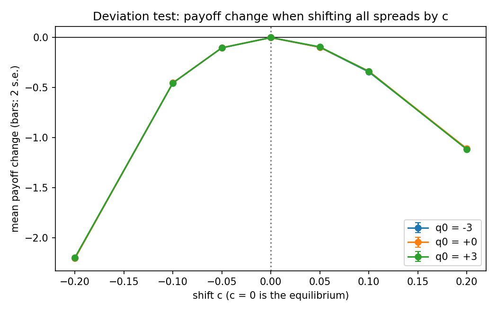
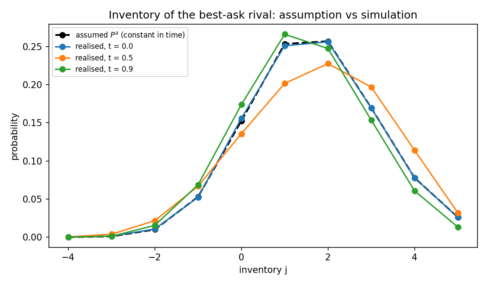

# Market Making Under Asymmetric Information and Competition: A Bid-Ask Spread Model

This repository accompanies an IEEE-format Game Theory course report. It implements an inventory-dependent market-making game inspired by Luo and Zheng, then examines the incentives to change quotes and the consistency of beliefs about competing makers' inventories.

The main finding is that none of the tested nonzero constant quote-distance changes improves the estimated objective in the fixed-belief experiment. A separate four-maker simulation shows why a fixed distribution of rival inventories deserves scrutiny when competitors' inventories evolve.

**Repository:** [https://github.com/Shlokkh7/market-making-game-theory](https://github.com/Shlokkh7/market-making-game-theory)  
**Submission version:** [v1.0-course-submission](https://github.com/Shlokkh7/market-making-game-theory/tree/v1.0-course-submission)

## Group members

| Member | Academic contact |
|---|---|
| Prashant Vijaykumar Sharma | u24ec050@eced.svnit.ac.in |
| Shlok Khandelwal | u24ec044@eced.svnit.ac.in |
| Khyati Srivastava | u24ec040@eced.svnit.ac.in |

Department of Electronics and Communications Engineering, Sardar Vallabhbhai National Institute of Technology, Surat, India. Names and affiliations are taken from the supplied report. This author list does not assign individual contribution roles that have not been supplied.

## The strategic game

- **Players:** competing market makers. Experiment B contains one reference maker and three rivals.
- **Strategies:** bid and ask distances from a public reference price, depending on time and the maker's own inventory. Quoted prices are `S - delta_bid` and `S + delta_ask`.
- **Information:** a maker knows its own inventory; rivals' inventories are represented by beliefs in the equilibrium calculation. Experiment B explicitly evolves those hidden states inside the simulator.
- **Incentives:** tighter quotes tend to attract more executions but earn a smaller margin per execution. Wider quotes increase the margin while reducing execution opportunities. Inventory penalties discourage excessive positions.
- **Objective:** expected terminal cash plus marked-to-market inventory, less a quadratic terminal inventory penalty and a running inventory-risk penalty. This objective includes the initial inventory endowment and is not simply cash trading profit.
- **Nash equilibrium:** within the theoretical game, each maker's strategy is a best response to the others' strategies. The numerical deviation experiment examines a particular family of unilateral changes; it does not exhaust all possible policies.

Inventory is restricted to integers from -5 to +5 in the simulation. A maker cannot sell at the lower boundary or buy at the upper boundary. Prices follow a driftless Brownian reference process; execution intensities depend on the maker's quote distance and the most competitive rival distance.

## Implementation

| File | Purpose |
|---|---|
| `mm_dynamic.py` | Computes the dynamic value correction and quote strategies using a backward-in-time explicit Euler grid and fixed-point best responses. Includes a separate benchmark intensity. |
| `mm_bayes.py` | Constructs rival-inventory priors and max/min distributions. Its standalone main routine also runs a separate noisy-observation Bayesian experiment. |
| `simulate_game.py` | Runs the fixed-belief reference-maker experiment, the explicit four-maker experiment, and plotting. |
| `tools/run_experiments.py` | Runs the original experiment functions in an isolated directory and retains numerical evidence and provenance. |
| `tools/verify_numerics.py` | Adds diagnostics without editing the three original scripts. |

The three original scientific scripts remain together in the repository root and retain their original bytes. The tools and documentation are additions. The primary figures do not require running the standalone Bayesian Monte Carlo experiment.

## Dataset and resources

There is **no external financial dataset**. Observations are synthetic: the program generates reference-price increments, execution draws, and rival starting inventories, then evolves cash and inventories according to the model. The bounded initial prior assigns weights proportional to `exp(-q^2 / (2 * 2.0^2))`; 2.0 is its scale parameter, not necessarily its exact standard deviation after truncation.

The source model is J. Luo and H. Zheng, “Dynamic Equilibrium of Market Making with Price Competition,” *Dynamic Games and Applications*, 11, 556-579, 2021. [Source paper](https://doi.org/10.1007/s13235-020-00373-w).

| Setting | Simulation value |
|---|---|
| Makers / rivals | 4 / 3 |
| Inventory bound | `Q = 5` |
| Horizon / initial price / initial cash | `T = 1`, `S0 = 20`, `X0 = 0` |
| Arrival parameters | `Lambda = 60`, `a = 2`, `k = 2` |
| Inventory risk / price volatility | `gamma = 1`, `sigma = 0.01` |
| Terminal penalty | `0.1 * q_terminal^2` |
| Solver steps / simulation substeps | 100 / 10; simulation increment 0.001 |
| Reference starting inventories | -3, 0, +3 |
| Experiment A / B seeds | 7 / 8 |
| Tested shifts | -0.20, -0.10, -0.05, 0, +0.05, +0.10, +0.20 |
| Quick paths, A / B | 4,000 / 2,000 |
| Full paths, A / B | 40,000 / 20,000 |

See [experiment configuration](https://github.com/Shlokkh7/market-making-game-theory/blob/v1.0-course-submission/docs/experiment-configuration.md) for the separate Bayesian defaults. Retained logs, summaries, and diagnostics are indexed in [results](https://github.com/Shlokkh7/market-making-game-theory/blob/v1.0-course-submission/results/README.md).

Retained resources include `console.log`, run manifests, `summary.json`, `experiment_A.csv`, `experiment_B.csv`, `deviations.csv`, and `beliefs.csv`. They contain generated observations and summary evidence; no external dataset download is needed.

## Experiments and principal figures

### Experiment A: fixed-belief reference maker

Rival behavior enters through the fixed inventory distributions used by the solver. The reference maker follows the computed policy or adds a constant `c` to both quote distances. Common random draws pair each deviation with the unshifted baseline.



All six plotted nonzero shifts reduce the estimated mean objective for starting inventories -3, 0, and +3. At a given state, a positive `c` widens the full bid-ask spread by `2c`; a negative `c` tightens it. The experiment illustrates the balance between execution probability, trading margin, and inventory exposure.

Error bars are twice the standard error of the **paired payoff difference**. The difference at zero is zero by construction. These results support stability against the tested constant shifts under fixed beliefs; they do not prove optimality against arbitrary deviations or establish equilibrium in the explicit four-maker simulation.

### Experiment B: explicit four-maker simulation

All four makers apply the computed quote map to their evolving inventories. The experiment compares the realised inventory distribution of the best-ask rival with the fixed distribution used to construct that map.



The dashed curve is the fixed assumption; the other curves are recorded at times 0.0, 0.5, and 0.9. These records concern the reference maker starting at inventory zero and show the ask side only. The largest visible discrepancy is at time 0.5; divergence is not monotonic over the whole horizon.

This is evidence about the fixed-belief assumption. It is not a plot of Bayesian learning, and it does not isolate the causal payoff cost of changing beliefs.

**Figure identity:** the supplied reference PNGs match the decoded pixels embedded in the supplied report PDF exactly. They are preserved in `figures/`. Newly generated images are retained separately; neither a pixel match nor metadata alone establishes the original generating command. See [provenance](https://github.com/Shlokkh7/market-making-game-theory/blob/v1.0-course-submission/docs/provenance.md).

### Recorded validation

Both the untouched quick command and the full experiment completed successfully. At initial inventory zero, the reproduced full-run fixed-belief value is 9.535127; Experiment A's mean is 9.548654 with standard error 0.009316, and Experiment B's mean is 9.569541 with standard error 0.013363. These reproduce the supplied report's baseline table at its printed precision.

Both full-run images reproduce the report references **pixel-for-pixel**, with zero differing decoded pixels. PNG file hashes differ because the container bytes differ; the original report PNGs remain unchanged. All 12 default-configuration numerical checks and five unit tests passed. The checks include root bracketing, first-order and fixed-point residuals, finite values, inventory-boundary rates, and quote monotonicity. They do not resolve time-grid bias or validate every parameter setting.

The full-run belief total-variation distances at times 0.0, 0.5, and 0.9 are 0.004162, 0.097912, and 0.055443. The report's approximate time-zero value of 0.03 does not describe this reproduced full run. Detailed evidence and remaining report wording issues are retained in the linked documentation.

## Implementation environment

The validation environment uses Python **3.13.7**, NumPy **2.5.5**, and Matplotlib **3.10.8** on Windows 11, build 26300. Validation status and measured runtimes are recorded with the results. These are the environment versions used for the new checks, not an assertion about the historical figure-generation environment.

Only NumPy and Matplotlib are direct third-party dependencies. Standard-library modules cover the remaining functionality. Linux, macOS, and Google Colab instructions are provided below; they should not be mistaken for separately tested environments.

## Local setup and execution

Install Python 3.13 and Git, then clone the repository using the actual published URL:

```text
git clone https://github.com/Shlokkh7/market-making-game-theory.git
cd market-making-game-theory
```

On Windows PowerShell:

```powershell
py -3.13 -m venv .venv
.\.venv\Scripts\python.exe -m pip install -r requirements.txt
.\.venv\Scripts\python.exe tools/run_experiments.py --quick --output-dir runs/quick
```

To run the full experiment:

```powershell
.\.venv\Scripts\python.exe tools/run_experiments.py --output-dir runs/full
```

On Linux or macOS with a compatible Python installation:

```bash
python3 -m venv .venv
source .venv/bin/activate
python -m pip install -r requirements.txt
python tools/run_experiments.py --quick --output-dir runs/quick
python tools/run_experiments.py --output-dir runs/full
```

The added runner keeps new figures and numerical evidence in the chosen output directory. Use a new directory name for another recorded run; the runner refuses to replace an existing recorded run. Runtime depends on hardware and path count. Full mode uses ten times as many paths as quick mode.

The original commands also remain valid from the repository root:

```text
python simulate_game.py --quick
python simulate_game.py
```

They print summaries and write `fig_sim_deviation.png` and `fig_sim_belief.png` into the current working directory, overwriting those names if present. They do not overwrite the separately stored `figures/` references. Prefer the added runner when retaining evidence.

Diagnostics and verification checks:

```text
python tools/verify_numerics.py --output runs/diagnostics.json
python -m unittest discover -s tests -v
```

### Google Colab

Open a new Python notebook in [Google Colab](https://colab.research.google.com/). In separate cells, clone and enter the repository, install its dependencies, and run a quick experiment:

```python
!git clone https://github.com/Shlokkh7/market-making-game-theory.git
%cd /content/market-making-game-theory
%pip install -r requirements.txt
```

```python
!python tools/run_experiments.py --quick --output-dir runs/colab-quick
```

```python
from IPython.display import Image, display
display(Image(filename="runs/colab-quick/fig_sim_deviation.png"))
display(Image(filename="runs/colab-quick/fig_sim_belief.png"))
```

Omit `--quick` and choose a new output directory for a full run. Colab's Python version can change, and the pinned packages must support that version. Restart the notebook runtime if Colab requests it after package installation, then return to the repository directory before running the experiment. Colab execution was not independently validated for this submission.

## Reproducibility and limits

The [reproducibility record](https://github.com/Shlokkh7/market-making-game-theory/blob/v1.0-course-submission/docs/reproducibility.md) distinguishes completed runs, recovered historical material, and checks not performed. The [numerical limitations](https://github.com/Shlokkh7/market-making-game-theory/blob/v1.0-course-submission/docs/numerical-limitations.md) describe the audit findings in detail.

The main qualifications are:

- The original fixed-point solver has a finite iteration limit and fixed root interval without an explicit failure report. Successful execution alone is not a convergence certificate.
- Solver time discretization and simulation substeps introduce different errors. Trading uses Bernoulli time-step arrivals, not exact event-driven Poisson simulation.
- Experiment B evolves interacting rival inventories, uses quote-availability conditioning and a no-rival-quote fallback, and is not a full exchange order book.
- The separate Bayesian experiment is a single-observation construction. Its fixed-belief “oracle” is not a solution of a fully observed multi-maker dynamic game. Its unversioned cache requires care.
- The inventory bound is linked across modules. Changing `Q` in one place is unsafe; the `paper_beliefs()` helper is not generally normalized for arbitrary bounds.
- There is no empirical market-data calibration. Historical refinement and benchmark percentages are not established by the baseline commands alone.

The repository omits the withdrawn static many-maker shortcut. [Report consistency notes](https://github.com/Shlokkh7/market-making-game-theory/blob/v1.0-course-submission/docs/report-consistency.md) identify descriptions and historical claims in the supplied report that need separate attention; the report itself has not been edited.

## Attribution and references

Scientific implementation: the supplied original project scripts, preserved with their recorded hashes. Repository documentation, evidence-export tools, and diagnostics were prepared with AI assistance and should be reviewed by the listed project group. Individual contributor roles have not been assigned beyond the report's author list.

The project group chose to publish this submission without an explicit software license. No `LICENSE` file is included.

1. J. Luo and H. Zheng, “Dynamic Equilibrium of Market Making with Price Competition,” *Dynamic Games and Applications*, vol. 11, pp. 556-579, 2021. [DOI](https://doi.org/10.1007/s13235-020-00373-w).
2. [NumPy random-stream compatibility documentation](https://numpy.org/doc/stable/reference/random/compatibility.html).
3. [Matplotlib documentation](https://matplotlib.org/stable/).

This technical companion is submitted separately from the IEEE report. No email, course upload, or Overleaf submission is performed by the repository preparation workflow.
